# Furkan Onat

**Full Stack Developer | Türkiye**

I build web, mobile and desktop applications and enjoy turning ideas into practical tools. I work on both frontend and backend, and I care about clean code and user privacy.

  

---

## Featured Projects

| Project | Description | Stack |
|---|---|---|
| [**Burrowl AI**](https://github.com/fo59/burrowl-ai) | Privacy-first AI assistant for your phone. Answers from the web with cited sources; personal data is removed before any search. | TypeScript · React Native |
| [**Flight Tracker Bot**](https://github.com/fo59/flight-tracker-bot) | Telegram bot for real-time flight tracking with takeoff, landing and delay alerts. Multiple flight data APIs with fallback. | Python · asyncio · SQLite |
| [**Student Records Manager**](https://github.com/fo59/fltk-student-manager) | Desktop app for managing student grades and exams, with search, filtering and report export. Tested and built with CI. | C++ · FLTK |
| [**Weather App**](https://github.com/fo59/pogoda-kivy) | 7-day weather forecast with city search over 1100+ cities. | Python · Kivy |

---

## About Me

- Building **Burrowl AI**, a privacy-first mobile AI assistant
- Learning **Next.js, TypeScript and Kivy**
- Interested in **Full Stack Development, Artificial Intelligence and Software Engineering**
- Always open to interesting projects and collaboration

---

## Tech Stack

### Programming Languages

  

### Frontend & Mobile

  

### Backend & Databases

  

### Tools & Libraries

  

---

## GitHub Statistics

  
  

---

  <picture>
    <source media="(prefers-color-scheme: dark)" srcset="https://raw.githubusercontent.com/fo59/fo59/output/github-snake-dark.svg" />
    <source media="(prefers-color-scheme: light)" srcset="https://raw.githubusercontent.com/fo59/fo59/output/github-snake.svg" />
    
  </picture>

  Building things, learning continuously, and improving with every commit.

